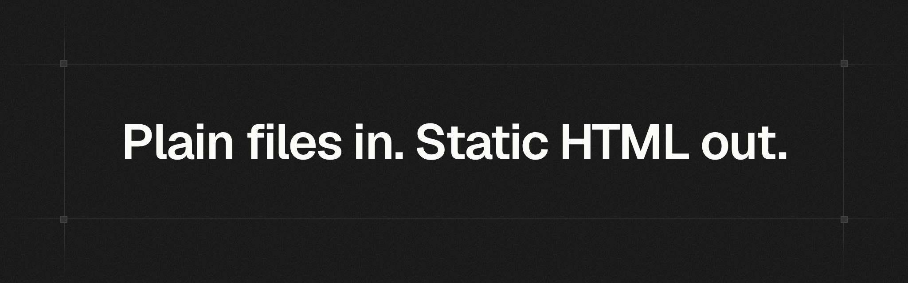

<br/>
<p align="center">
  <a href="https://fragmentor.io">Fragmentor</a> is an AI website builder with a builtin CMS.<br/>
  Its open-source build engine turns your content and HTML templates into fast, static HTML.
</p>

<p align="center">
  <a href="https://github.com/fragmentorio/fragmentor/blob/main/LICENSE"></a>
  <a href="https://www.npmjs.com/package/fragmentor"></a>
</p>

## Install

Install Fragmentor in your project by running the command below:

```bash
npm install fragmentor
```

For minified CSS/JS and responsive WebP images in production builds, also install the optional optimizers:

```bash
npm install --save-dev esbuild sharp
```

Looking for help? Start with the [documentation](https://fragmentor.io/docs).

## Commands

```bash
npx fragmentor dev      # start a dev server at http://localhost:3000
npx fragmentor build    # build the site to dist/
```

Run `npx fragmentor --help` to see all commands and options.

## Links

- [Website](https://fragmentor.io)
- [Documentation](https://fragmentor.io/docs)
- [Changelog](https://fragmentor.io/changelog)
- [Blog](https://fragmentor.io/blog)
- [Discord](https://discord.gg/9aH7gRhcyQ)
- [License (MIT)](https://github.com/fragmentorio/fragmentor/blob/main/LICENSE)

